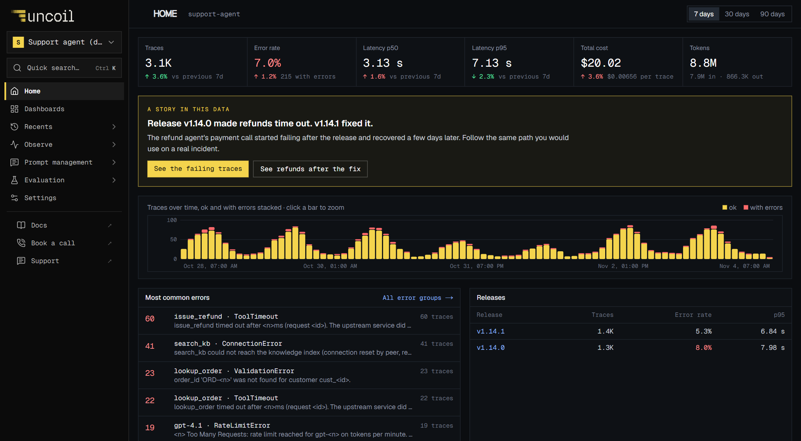

<p align="center">
  <a href="https://www.uncoil.dev">
    
  </a>
</p>

<p align="center"><b>Find out why your AI agent failed, what it cost, and whether the fix worked.</b></p>

<p align="center">
  <a href="https://www.uncoil.dev/demo"></a>
</p>
<p align="center"><sub>Inside Uncoil · Public demo with sample data</sub></p>

<h3 align="center">
  <a href="https://www.uncoil.dev">Website</a> ·
  <a href="https://www.uncoil.dev/demo">Live demo</a> ·
  <a href="https://www.uncoil.dev/docs/quickstart">Quickstart</a>
</h3>

<p align="center">
  <a href="https://www.uncoil.dev/docs">Documentation</a> ·
  <a href="https://www.uncoil.dev/pricing">Pricing</a> ·
  <a href="https://www.uncoil.dev/blog">Blog</a> ·
  <a href="https://www.uncoil.dev/changelog">Changelog</a> ·
  <a href="https://www.uncoil.dev/status">Status</a> ·
  <a href="https://www.uncoil.dev/security">Security</a>
</p>

---

### What Uncoil does

Agents fail in quiet ways. Uncoil shows each run step by step so you find the cause fast.

- **Trace** every run, model call and tool call
- **Diagnose** failures, slow steps and cost spikes
- **Compare** releases and see if a change helped
- **Alert** your team before users notice

### Start in one paste

```bash
npm install @uncoil.dev/sdk   # TypeScript
pip install uncoil-sdk        # Python
```

Then follow the [quickstart](https://www.uncoil.dev/docs/quickstart) to send your first trace.

### Repositories

- [Uncoil-dev/Uncoil](https://github.com/Uncoil-dev/Uncoil): the app, docs and SDKs

### Contact

[hello@uncoil.dev](mailto:hello@uncoil.dev) · Made in Norway
